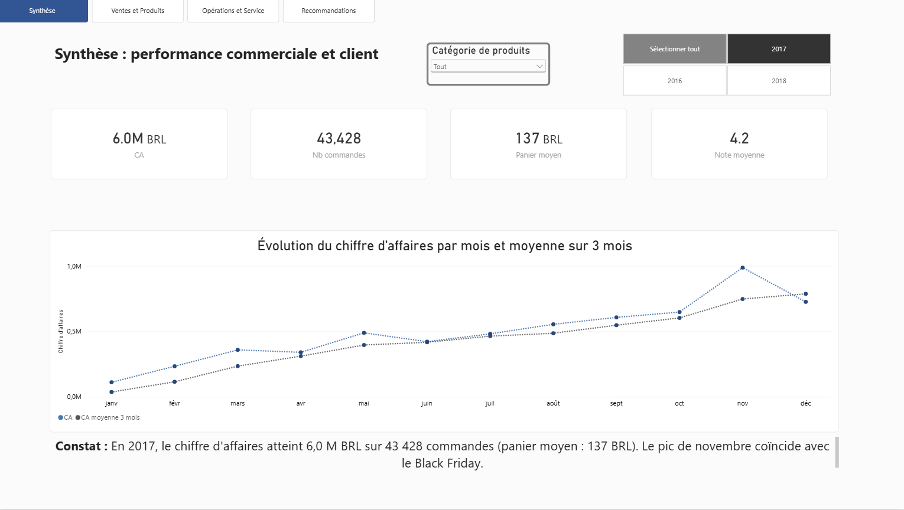
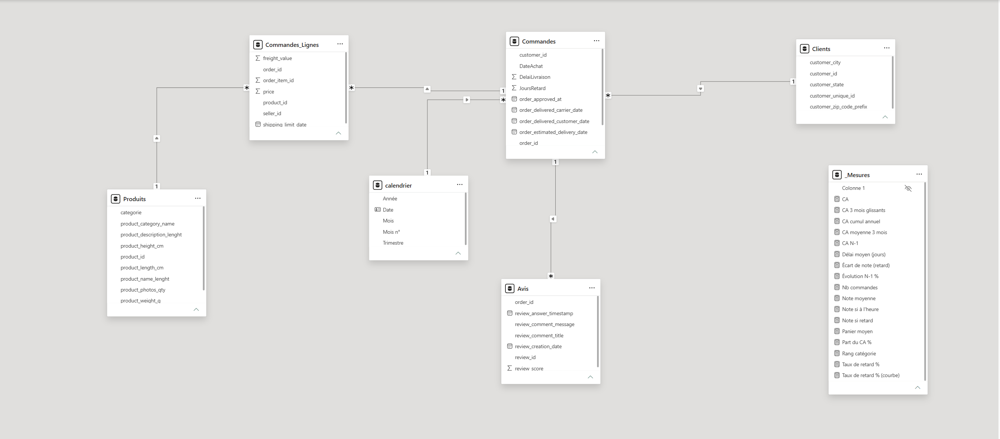
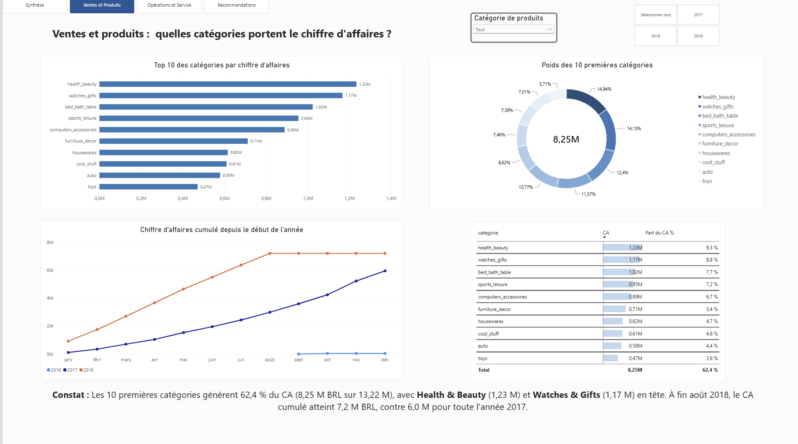
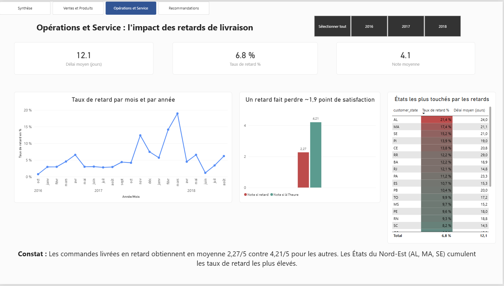
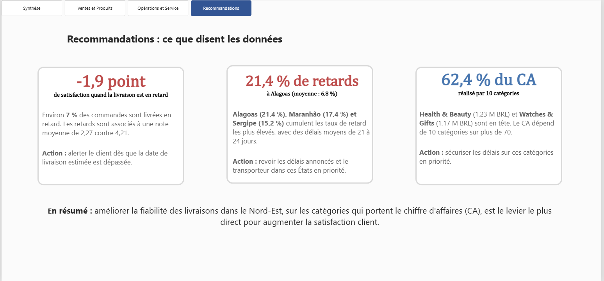

# Dashboard Power BI : performance commerciale et client (Olist)

Rapport Power BI en 4 pages analysant les ventes, la livraison et la satisfaction client d'une plateforme e-commerce brésilienne (~96 500 commandes livrées, 2016-2018).

**Outils :** Power BI Desktop · Power Query (M) · DAX · modélisation en étoile



---

## 1. Objectif et questions métier

Construire un tableau de bord de pilotage répondant à quatre questions :

1. Comment évolue le chiffre d'affaires (CA), et quel est le poids de chaque période ?
2. Quelles catégories de produits portent le CA ?
3. Les retards de livraison dégradent-ils la satisfaction client, et où se concentrent-ils ?
4. Quelles actions opérationnelles en découlent ?

## 2. Données

- **Source :** [Brazilian E-Commerce Public Dataset by Olist (Kaggle)](https://www.kaggle.com/datasets/olistbr/brazilian-ecommerce)
- **Tables utilisées (6 CSV) :** commandes, lignes de commande, avis clients, clients, produits, traduction des catégories
- **Devise :** BRL (real brésilien). Les montants ne sont pas convertis.
- **Période :** septembre 2016 à août 2018 (2016 ne couvre que septembre à décembre, 2018 s'arrête fin août).

Les fichiers CSV ne sont pas inclus dans ce dépôt (taille) : à télécharger sur Kaggle.

## 3. Préparation des données (Power Query)

- Typage des colonnes (dates en Date/Heure, montants en nombre décimal avec paramètres régionaux anglais pour lire le séparateur « . »)
- Filtre des commandes sur le statut `delivered` (96 478 commandes)
- Jointure interne sur les lignes de commande, pour ne garder que les articles des commandes livrées
- Traduction des catégories portugais → anglais par fusion avec la table de traduction
- Suppression des doublons d'avis (un avis par commande, le plus récent)
- Colonnes calculées : `DelaiLivraison` (jours entre achat et livraison), `JoursRetard` (jours entre date estimée et date réelle), `DateAchat` (date seule)

## 4. Modèle de données

Schéma en étoile : `Commandes` au centre, relié à `calendrier`, `Clients`, `Commandes_Lignes` (puis `Produits`) et `Avis`. Table dédiée `_Mesures` pour ranger les mesures DAX. Toutes les relations sont de type un-à-plusieurs, filtre unique.



## 5. Mesures DAX principales

```dax
CA = SUM(Commandes_Lignes[price])

Nb commandes = DISTINCTCOUNT(Commandes_Lignes[order_id])

Panier moyen = DIVIDE([CA], [Nb commandes])

CA N-1 = CALCULATE([CA], SAMEPERIODLASTYEAR(calendrier[Date]))

Évolution N-1 % = DIVIDE([CA] - [CA N-1], [CA N-1])

CA cumul annuel = TOTALYTD([CA], calendrier[Date])

CA 3 mois glissants =
CALCULATE([CA], DATESINPERIOD(calendrier[Date], MAX(calendrier[Date]), -3, MONTH))

CA moyenne 3 mois = DIVIDE([CA 3 mois glissants], 3)

Part du CA % = DIVIDE([CA], CALCULATE([CA], ALL(Produits[categorie])))

Rang catégorie = RANKX(ALL(Produits[categorie]), [CA])

Délai moyen (jours) = AVERAGE(Commandes[DelaiLivraison])

Taux de retard % =
DIVIDE(
    CALCULATE(COUNTROWS(Commandes), Commandes[JoursRetard] > 0),
    COUNTROWS(Commandes)
)

Taux de retard % (courbe) =
IF([Nb commandes] >= 100, [Taux de retard %])

Note moyenne = AVERAGE(Avis[review_score])

Note si retard = CALCULATE([Note moyenne], Commandes[JoursRetard] > 0)

Note si à l'heure = CALCULATE([Note moyenne], Commandes[JoursRetard] <= 0)

Écart de note (retard) = [Note si retard] - [Note si à l'heure]
```

**Choix d'analyse :** la mesure `Taux de retard % (courbe)` masque les mois de moins de 100 commandes, car un taux calculé sur un très petit échantillon est trompeur (par exemple 100 % en septembre 2016).

## 6. Le rapport en 4 pages

### Page 1 : Synthèse
CA, nombre de commandes, panier moyen et note moyenne, avec l'évolution mensuelle du CA et sa moyenne sur 3 mois. Filtres par année et par catégorie.

### Page 2 : Ventes et produits
Top 10 des catégories, poids des 10 premières catégories, CA cumulé depuis le début de l'année par année, tableau de synthèse avec part du CA.



### Page 3 : Opérations et service
Délai moyen, taux de retard, note moyenne, évolution mensuelle du taux de retard, comparaison des notes avec et sans retard, classement des États par taux de retard (mise en forme conditionnelle).



### Page 4 : Recommandations
Trois constats chiffrés, chacun associé à une action.



## 7. Principaux résultats

| Indicateur | Valeur |
|---|---|
| CA (commandes livrées) | 13,22 M BRL |
| Commandes livrées | 96 478 |
| Panier moyen | 137 BRL |
| Délai moyen de livraison | 12,1 jours |
| Taux de retard global | 6,8 % |
| Note moyenne | 4,1 / 5 |

## 8. Constats et recommandations

**1. Les retards sont associés à une forte baisse de satisfaction.**
Les commandes livrées en retard obtiennent une note moyenne de **2,27** contre **4,21** pour les autres (**-1,9 point**).
*Action :* alerter le client dès que la date de livraison estimée est dépassée.

**2. Les retards se concentrent dans le Nord-Est du Brésil.**
Alagoas (21,4 %), Maranhão (17,4 %) et Sergipe (15,2 %) affichent les taux de retard les plus élevés, contre 6,8 % en moyenne, avec des délais moyens de 21 à 24 jours.
*Action :* revoir les délais annoncés et le transporteur dans ces États en priorité.

**3. Le CA dépend d'un petit nombre de catégories.**
Les 10 premières catégories (sur plus de 70) génèrent **62,4 %** du CA (8,25 M BRL sur 13,22 M), avec `health_beauty` (1,23 M) et `watches_gifts` (1,17 M) en tête.
*Action :* sécuriser les délais de livraison sur ces catégories en priorité.

## 9. Limites

- Corrélation, pas causalité : les données montrent que les retards vont avec de mauvaises notes, sans prouver qu'ils en sont la seule cause.
- 2016 ne couvre que 4 mois et 2018 s'arrête fin août : les comparaisons annuelles (N-1) sont à interpréter avec prudence.
- Pas de données de coûts : l'analyse porte sur le CA, pas sur la marge.

## 10. Contenu du dépôt

```
├── README.md
├── olist_dashboard.pdf        # export du rapport
├── powerBI_modele.pbix        # fichier Power BI (si < 100 Mo)
└── images/
    ├── modele.png
    ├── page1_synthese.png
    ├── page2_ventes_produits.png
    ├── page3_operations_service.png
    └── page4_recommandations.png
```

## Auteure

**Hillary Winny Kerekou** · Étudiante ingénieure Data Science & IoT (SUP MTI, Rabat)
[LinkedIn](https://www.linkedin.com/in/kerekou-hillary-winny-2a0859207/) · [GitHub](https://github.com/Hillary05)
